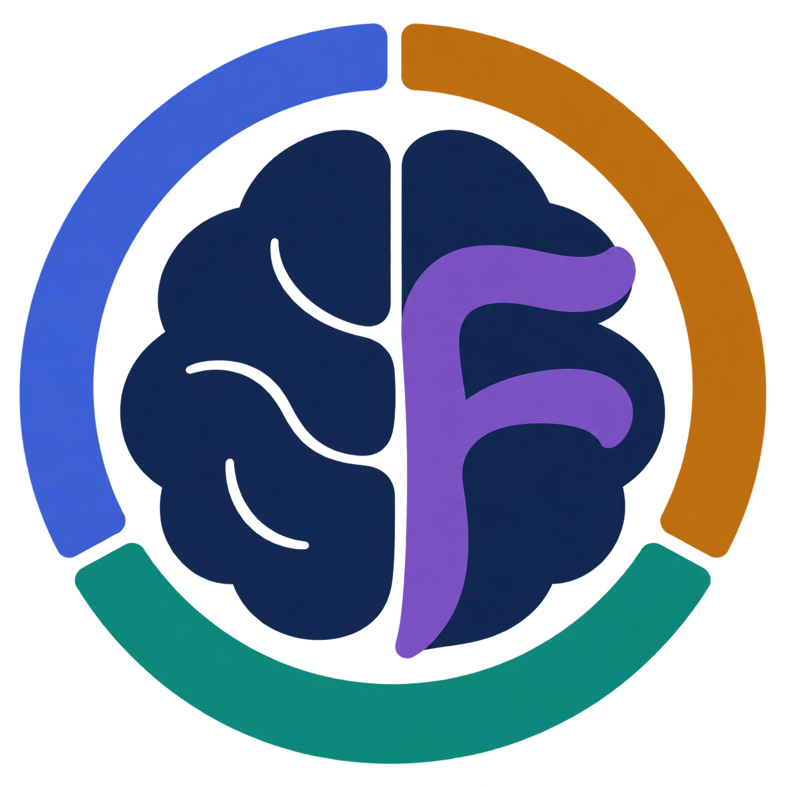
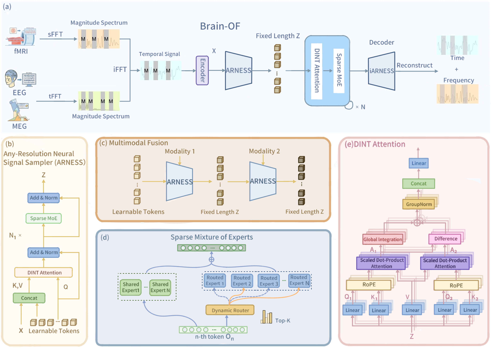

<p align="center">
  
</p>

<h1 align="center">Brain-OF: An Omnifunctional Foundation Model<br>for fMRI, EEG and MEG</h1>

<p align="center">
  <strong>NeurIPS 2026</strong><br>
  Hanning Guo · Hanwen Bi · Farah Abdellatif · Andrei Galbenus ·<br>
  Jon. N. Shah · Abigail Morrison · Jürgen Dammers
</p>

<p align="center">
  <a href="https://hanningguo.github.io/BrainOF/"></a>
  <a href="https://arxiv.org/abs/2602.23410"></a>
  <!-- Replace this section link with the Hugging Face repository or collection URL. -->
  <a href="https://huggingface.co/collections/han-ning/brain-of"></a>
  <a href="LICENSE"></a>
</p>

<p align="center">
  <strong>
    <a href="#overview">Overview</a> &nbsp;·&nbsp;
    <a href="#model-zoo">Model Zoo</a> &nbsp;·&nbsp;
    <a href="#getting-started">Getting Started</a> &nbsp;·&nbsp;
    <a href="#repository-structure">Repository Structure</a> &nbsp;·&nbsp;
    <a href="#citation">Citation</a>
  </strong>
</p>

Official implementation of **Brain-OF**, a foundation model jointly pretrained on **fMRI, EEG, and MEG**. A shared backbone learns from heterogeneous neural signals and supports both unimodal and multimodal downstream tasks.

## News

- **2026-09:** Brain-OF was accepted at **NeurIPS 2026**.
- **2026-02:** The Brain-OF paper was released on [arXiv](https://arxiv.org/abs/2602.23410).

## Overview

Brain-OF combines complementary information from fMRI, EEG, and MEG, aiming to learn richer representations through **cross-modal synergy**.

- **Any-resolution inputs.** The **Any-Resolution Neural Signal Sampler (ARNESS)** maps signals with different channel/ROI counts and temporal resolutions into a shared space of 128 latent tokens.
- **Addressing semantic heterogeneity.** **Sparse MoE** combines shared experts for modality-invariant structure with routed experts for modality-specific semantics. **DINT attention** suppresses irrelevant context while integrating local and global dependencies.
- **Joint time-frequency pretraining.** **Masked Temporal-Frequency Modeling (MTFM)** learns by reconstructing masked signals in both temporal and Fourier domains.
- **Large-scale pretraining and flexible adaptation.** Pretrained on **37 public datasets** with **5.87 million samples** from **32,278 participants**, the backbone supports unimodal and multimodal inputs.

<p align="center">
  
  <br>
  <em>Brain-OF architecture and pretraining pipeline. </em>
</p>

## Model Zoo

Pretrained Base, Large, and Huge checkpoints are available on Hugging Face.

| Model | Total parameters | Active parameters | Backbone layers | Checkpoint |
| --- | ---: | ---: | ---: | --- |
| Brain-OF Base | 47.5M | 21.5M | 12 | [](https://huggingface.co/han-ning/Brain-OF-Base) |
| Brain-OF Large | 331M | 150M | 24 | [](https://huggingface.co/han-ning/Brain-OF-Large) |
| Brain-OF Huge | 1.7B | 500M | 36 | [](https://huggingface.co/han-ning/Brain-OF-Huge) |
| Brain-OF Giant | 9B | 1.2B | 48 | [](https://huggingface.co/han-ning/Brain-OF-Giant) |

## Getting Started

<p align="center">
  <a href="#installation">Installation</a> ·
  <a href="#data-preparation">Data Preparation</a> ·
  <a href="#training-configuration">Training Configuration</a> ·
  <a href="#pretraining">Pretraining</a> ·
  <a href="#finetuning">Finetuning</a> ·
  <a href="#multimodal-finetuning">Multimodal Finetuning</a>
</p>

The end-to-end workflow is:

```text
Source datasets
    -> modality-specific preprocessing
    -> HDF5 samples (signal, label)
    -> LMDB datasets
    -> pretraining or downstream finetuning
```

### Installation

Brain-OF use **Linux with NVIDIA GPUs, Python 3.14, and PyTorch 2.10.0 with CUDA 13.0**. Create the `brainof` environment, install the CUDA-enabled PyTorch build, and then install the remaining dependencies:

```bash
git clone https://github.com/HanningGuo/BrainOF.git
cd BrainOF

conda create --name brainof python=3.14 -y
conda activate brainof
python -m pip install --upgrade pip

python -m pip install torch==2.10.0 torchvision==0.25.0 torchaudio==2.10.0 \
  --index-url https://download.pytorch.org/whl/cu130

python -m pip install -r requirements.txt
```

For a different CUDA version, use the corresponding [PyTorch 2.10.0 installation command](https://pytorch.org/get-started/previous-versions/#v2100) before installing `requirements.txt`. Training uses CUDA/NCCL and requires `torchrun`, including single-GPU runs.

Check the environment before preparing a training run:

```bash
python -m pip check
python -c "import main_pretraining, main_finetuning, main_finetuning_multimodal; print('Training imports OK')"
python -c "import mne, h5py, nibabel, pymatreader, pandas, pyprep, lmdb; print('Preprocessing imports OK')"
python -c "import torch; print('PyTorch:', torch.__version__); print('CUDA:', torch.version.cuda); print('GPU available:', torch.cuda.is_available())"
```

`GPU available` should be `True` for training.

### Data Preparation

Preprocessing scripts are in [`dataset_maker/`](dataset_maker/). They are **dataset-specific templates**: edit their input/output paths, split settings, and any atlas paths before running. Obtain each source dataset from its original provider under its access terms.

| Modality | Preparation | Example scripts |
| --- | --- | --- |
| EEG | MNE-based reading and preprocessing, dataset-specific channel selection, filtering/resampling, and segmentation | [`make_TUAB.py`](dataset_maker/make_TUAB.py), [`make_TUEG.py`](dataset_maker/make_TUEG.py), [`make_LEMON.py`](dataset_maker/make_LEMON.py) |
| MEG | MNE-based preprocessing and segmentation with consistent sensor ordering | [`make_OMEGA.py`](dataset_maker/make_OMEGA.py), [`make_CamCAN.py`](dataset_maker/make_CamCAN.py), [`make_HCP_YA_MEG.py`](dataset_maker/make_HCP_YA_MEG.py) |
| fMRI | fMRIPrep or dataset-provided derivatives, followed by ROI time-series extraction and segmentation | [`run_fMRIprep.sh`](dataset_maker/run_fMRIprep.sh), [`make_ABIDE1.py`](dataset_maker/make_ABIDE1.py), [`make_HCP_YA_fMRI.py`](dataset_maker/make_HCP_YA_fMRI.py) |

For fMRI, `run_fMRIprep.sh` is a Slurm/Apptainer template. Configure the BIDS input, container image, FreeSurfer license, output/work directories, and computing resources separately from the Python environment. Then use the corresponding `make_*.py` script to extract and segment ROI signals. Match the atlas space and resolution to the preprocessed fMRI.


#### Step 1: Generate HDF5 Samples

Run preprocessing from `dataset_maker/`:

```bash
cd dataset_maker

# First edit the paths and settings inside this script.
python make_TUAB.py

cd ..
```

Each sample should contain `signal`, a numeric array of shape **`(channels_or_ROIs, time_points)`**, and `y`, the task target.

#### Step 2: Convert HDF5 to LMDB

Edit these settings in [`dataset_maker/transform2lmdb.py`](dataset_maker/transform2lmdb.py):

```python
root = "/path/to/hdf5_root"
save_path = "/path/to/lmdb_root"
datasets = ["TUAB"]
```

Then run:

```bash
python dataset_maker/transform2lmdb.py

# Multimodal only: configure and run after preparing each modality's LMDB.
python dataset_maker/transform2multimodal.py
```

Configure the input and output paths directly in `transform2lmdb.py`. Each input split directory should contain only HDF5 samples. The expected layout is:

```text
hdf5_root/                       lmdb_root/
└── TUAB/                        └── TUAB/
    ├── train/*.h5                   ├── train/BrainSignal.lmdb/
    ├── val/*.h5                     ├── val/BrainSignal.lmdb/
    └── test/*.h5                    └── test/BrainSignal.lmdb/
```

**LMDB is the training input format.** Set the training configuration's `root` to `lmdb_root`, the parent of the dataset folders.

<!-- The TUEG pipeline is an exception: `make_TUEG.py` includes its own tar/HDF5-to-LMDB conversion. It also uses the TUAB subject list to exclude evaluation subjects; configure that input before preprocessing. -->

<details>
<summary><strong>Adding a new dataset: preprocessing and storage</strong></summary>

1. Adapt the closest `make_*.py` script to your acquisition format, channel/ROI ordering, sampling rate, window length, labels, and split policy.
2. Export the `signal`/`y` HDF5 schema and convert it to the same LMDB layout. Match target encoding to the task: classification tasks commonly use one-hot targets, whereas regression uses continuous values.

For custom LMDB writers, each sample is a pickled `{"signal": signal, "y": target}` dictionary under an ASCII sample key. The reserved `__keys__` entry stores a pickled list of `{"dataset": dataset_name, "key": sample_key}` records. See [`transform2lmdb.py`](dataset_maker/transform2lmdb.py) and [`BrainSignalDataset.py`](datasets/BrainSignalDataset.py) for the exact contract.

</details>

### Training Configuration

Choose a YAML from [`configs/`](configs/) that matches your model and task. Defaults in [`utils/config.py`](utils/config.py) are overridden first by the YAML and then by supported command-line arguments. The table below summarizes common parameters, their types or allowed values, and their purposes.

| Parameter | Type / values | Description |
| --- | --- | --- |
| `root` / `out_root` | Path strings | Parent directory of the LMDB datasets / directory for training outputs. |
| `dataset.name` | String or list of strings | Exact dataset folder name; use a list for a pretraining corpus. Paired finetuning expects one folder name. |
| `dataset.signal_size` | Two positive integers: `[channels_or_ROIs, time_points]` | Use the dataset's maximum time-point count to avoid truncation; see [Input Size and Tokenization](#input-size-and-tokenization).|
| `model.name` | String | Model factory name matching the desired size. |
| `model.max_seq_length` | Positive integer | Cover the largest per-sample token count across input modalities. A compact budget reduces padding during finetuning; defaults to `2048`. See [Input Size and Tokenization](#input-size-and-tokenization).|
| `model.num_classes` | Positive integer | Number of downstream classes or output values; use `1` for scalar regression. |
| `model.init_scale` | Float | Scales the initialized weights and bias of the downstream linear prediction head. |
| `train.metrics` | List of metric names | Metrics to report; see [`metrics_fn.py`](utils/metrics_fn.py) for supported names. |
| `train.main_metric` | One entry from `train.metrics` | Validation metric for selecting the best checkpoint, e.g. `bac` for classification or `mae` for regression. |
| `train.batch_size` | Positive integer | Batch size **per GPU**, before gradient accumulation. |
| `train.accumulation_steps` | Integer ≥ 1 | Number of batches accumulated per optimizer step. |
| `train.optimizer.base_lr` | Positive float | Base rate at the reference global batch size; automatically scales with effective global batch size. Retune for your setup; see [Batch Size and Learning Rate Scaling](#batch-size-and-learning-rate-scaling) below. |
| `train.clip_grad` | Positive float or `null` | Maximum gradient norm; `null` disables gradient clipping. |
| `train.optimizer.layer_decay` | Float (typically `0.0 < value ≤ 1.0`) | Finetuning learning-rate decay across layer groups: values below `1` reduce earlier-layer rates, and `1.0` disables layer-wise decay. |
| `model.pretrained_model` / `model.resume` | Checkpoint paths or `null` | Initialize a downstream encoder / resume a training checkpoint. See [Checkpoints](#checkpoints) for formats. |
| `model.use_lora` / `model.enable_lp` | `true` / `false` | Enable LoRA or frozen-backbone probing; see [Full finetuning, LoRA, and probing](#full-finetuning-lora-and-probing). |
| `distribute.parallelism` | `DDP` / `FSDP` | Distributed training strategy; match the checkpoint format when loading weights. |
<!-- | `num_workers` | Positive integer | Data-loading worker processes per GPU. |
| `pin_memory` | `true` / `false` | Use pinned host memory for data transfer to the GPU. |
| `amp_enable` | `true` / `false` | Enable automatic mixed precision with BF16 autocast. |
| `model.use_checkpoint` | `true` / `false` | Recompute activations during backward to reduce GPU memory use. |
| `seed` | Nonnegative integer or `null` | Set the random seed; `null` leaves it unset. |
| `print_freq` / `save_freq` | Positive integers | Logging interval in batches / checkpoint interval in epochs. |
| `train.criterion.task` | `classification` / `prediction` | Downstream task type; use `prediction` for regression. |
| `train.lr_scheduler.warmup_epochs` | Integer ≥ 0 | Warmup duration; keep below `train.epochs`. |
| `train.epochs` | Positive integer | Total number of training epochs. | -->
<!-- | `train.optimizer.weight_decay` | Float ≥ 0 | AdamW weight decay. |
| `train.lr_scheduler.warmup_lr` / `train.lr_scheduler.min_lr` | Floats ≥ 0 | Warmup starting learning rate / cosine schedule minimum; both are scaled with batch size. |
| `eval_mode` | `true` / `false` | Evaluate a downstream checkpoint without training. | -->


<!-- <p align="justify">
Logs, TensorBoard events, and checkpoints are saved under <code>&lt;out_root&gt;/results/Pretraining/&lt;run&gt;/</code> for pretraining and <code>&lt;out_root&gt;/results/&lt;dataset&gt;/&lt;run&gt;/</code> for finetuning.
</p> -->

<a id="input-size-and-tokenization"></a>
<details>
<summary><strong>Input Size and Tokenization</strong></summary>

Set `dataset.signal_size` to `[channels_or_ROIs, time_points]`, using the **maximum number of time points in the prepared dataset** to avoid truncation. Cover all splits used in the run and, for paired inputs, both modalities. A smaller `time_points` value truncates longer signals; the channel/ROI entry does not crop channels.

Choose `model.max_seq_length` to fit the largest token count required by your data. [`DataTransform`](datasets/transform.py) normalizes each channel, divides the signal into patches of **64 time points**, and pads the token sequence to this budget. During finetuning, a compact budget reduces unnecessary padding and GPU memory use:

```text
tokens_per_sample = channels_or_ROIs × ceil(time_points_after_clipping / 64)
model.max_seq_length = max(tokens_per_sample over all samples and input modalities)
```

For example, TUAB needs `19 × ceil(2000 / 64) = 608` tokens, so its finetuning YAML uses `model.max_seq_length: 608` rather than padding to the default 2048. Paired modalities are padded separately using the same budget.

Each sample must fit within `model.max_seq_length`; otherwise, padding fails. With more than **2048 valid input tokens**, some input positions overlap ARNESS's fixed latent positions, introducing relative positions between input and latent tokens that were not seen during pretraining. This may affect downstream performance; validate longer inputs before use.

</details>

<a id="batch-size-and-learning-rate-scaling"></a>
<details>
<summary><strong>Batch Size and Learning Rate Scaling</strong></summary>

`train.batch_size` is the batch size **per GPU**. We scale learning rates using the effective global batch size:

```text
effective_global_batch = train.batch_size × number_of_GPUs × train.accumulation_steps
scaled_base_lr = train.optimizer.base_lr × effective_global_batch / reference_batch
```

| Training entry point | Reference global batch size |
| --- | ---: |
| Pretraining | 7168 |
| Unimodal finetuning | 1024 |
| Multimodal finetuning | 512 |

For example, unimodal finetuning with `base_lr: 1e-4` and an effective global batch of 256 gives a scaled base learning rate of `2.5e-5`.

`train.lr_scheduler.warmup_lr`, `train.lr_scheduler.min_lr`, and the router bias update rate `train.aux_loss_free_alpha` use the same factor. Learning-rate scheduling and layer-wise decay apply after scaling.

**Retune the learning rate for your dataset and effective batch size: linear scaling does not guarantee an optimum.**

</details>

<a id="checkpoints"></a>
<details>
<summary><strong>Checkpoints</strong></summary>

Use `--pretrained_model` to initialize the encoder for finetuning, or `--resume` to restore a training checkpoint for continued training or evaluation. Set `distribute.parallelism` to match the checkpoint format:

- **DDP (Base, Large, Huge):** pass a `.pth` file.
- **FSDP (Giant):** pass the path of the checkpoint directory.

</details>

### Pretraining

Configure your pretraining run using the YAML for your model size (**Base**, **Large**, **Huge**, or **Giant**) in [`configs/`](configs/):

- Set `dataset.name` to the list of prepared datasets you want to use.
- Check that each dataset is registered under `dataset.modality.fMRI`, `dataset.modality.EEG`, or `dataset.modality.MEG`. Existing mappings are defined in [`utils/config.py`](utils/config.py); add or update them in the YAML as needed. These modality mappings select spatial-frequency masking for fMRI and temporal-frequency masking for EEG/MEG.

Launch **Base** pretraining on a single GPU:

```bash
torchrun --standalone --nnodes=1 --nproc_per_node=1 main_pretraining.py \
  --cfg configs/BrainOF_Base_Pretraining.yaml \
  --root /path/to/lmdb_root \
  --out_root /path/to/outputs \
  --batch_size 8
```

For single-node multi-GPU training, set `--nproc_per_node` to the number of GPUs and adjust `--batch_size` to fit GPU memory.

To submit a **multi-node job on Slurm**, edit the [`brainof_pretraining.sh`](brainof_pretraining.sh) template to match your cluster: set the node/GPU counts, account, partition, environment, paths, and network interfaces. Then submit the job:

```bash
sbatch brainof_pretraining.sh
```

### Finetuning

Adapt a pretrained Brain-OF checkpoint to your downstream task with a task YAML from [`configs/`](configs/) that matches the model size. Check the [Checkpoints](#checkpoints) when choosing DDP or FSDP. The example below finetunes **Base** for **TUAB abnormality classification** on a single GPU:

```bash
torchrun --standalone --nnodes=1 --nproc_per_node=1 main_finetuning.py \
  --cfg configs/BrainOF_Base_TUAB.yaml \
  --root /path/to/lmdb_root \
  --out_root /path/to/outputs \
  --pretrained_model /path/to/brainof_base_50M_A22M.pth \
  --batch_size 8
```

For **cluster training**, use [`brainof_finetuning.sh`](brainof_finetuning.sh) as a Slurm submission template. Adjust the script for your cluster and set `root`, `out_root`, and `model.pretrained_model` in the task YAML, then submit:

```bash
sbatch brainof_finetuning.sh
```

<a id="full-finetuning-lora-and-probing"></a>
<details>
<summary><strong>Full finetuning, LoRA, and probing</strong></summary>

Choose a finetuning strategy using the following flags in your YAML's `model` section:

| Adaptation | `use_lora` | `enable_lp` |
| --- | --- | --- |
| Full finetuning | `False` | `False` |
| LoRA | `True` | `False` |
| Frozen-backbone probing | `False` | `True` |

</details>

<a id="evaluation"></a>
<details>
<summary><strong>Evaluation</strong></summary>

To evaluate a **finetuned** checkpoint, use the same task configuration and adaptation flags, with `--resume` and `--eval_mode`:

```bash
torchrun --standalone --nnodes=1 --nproc_per_node=1 main_finetuning.py \
  --cfg configs/BrainOF_Base_TUAB.yaml \
  --root /path/to/lmdb_root \
  --out_root /path/to/outputs \
  --resume /path/to/checkpoint-best.pth \
  --eval_mode \
  --batch_size 8
```

</details>

### Multimodal Finetuning

Finetune a **Base** checkpoint for age group classification with **LEMON fMRI + EEG**, setting `dataset.name` to `LEMON` in the task YAML:

```bash
torchrun --standalone --nnodes=1 --nproc_per_node=1 main_finetuning_multimodal.py \
  --cfg configs/BrainOF_Base_LEMON_multimodal.yaml \
  --root /path/to/lmdb_root \
  --out_root /path/to/outputs \
  --pretrained_model /path/to/brainof_base_50M_A22M.pth \
  --batch_size 8
```

For **cluster training**, modify the [`brainof_finetuning_multimodal.sh`](brainof_finetuning_multimodal.sh) Slurm template and point its `--cfg` to the LEMON YAML above. Set the dataset, output, and checkpoint paths in that YAML, then submit:

```bash
sbatch brainof_finetuning_multimodal.sh
```

## Repository Structure

| Path | Purpose |
| --- | --- |
| [`dataset_maker/`](dataset_maker/) | Dataset preprocessing, HDF5/LMDB conversion, multimodal pairing, and fMRIPrep template |
| [`datasets/`](datasets/) | LMDB readers and signal transforms |
| [`configs/`](configs/) | Model- and task-specific YAML configurations |
| [`models/mtfm.py`](models/mtfm.py) | Masked temporal-frequency pretraining model |
| [`models/transformer.py`](models/transformer.py) | ARNESS, DINT attention, sparse experts, and unimodal downstream models |
| [`models/transformer_multimodal.py`](models/transformer_multimodal.py) | Multimodal downstream models |
| [`main_pretraining.py`](main_pretraining.py) / [`engine_pretraining.py`](engine_pretraining.py) | Pretraining entry point and training loop |
| [`main_finetuning.py`](main_finetuning.py) / [`engine_finetune.py`](engine_finetune.py) | Unimodal adaptation and evaluation |
| [`main_finetuning_multimodal.py`](main_finetuning_multimodal.py) / [`engine_finetune_multimodal.py`](engine_finetune_multimodal.py) | Multimodal adaptation and evaluation |
| [`utils/`](utils/) | Configuration defaults, logging, metrics, and checkpoint utilities |

## License

Code is released under the [Apache License 2.0](LICENSE). Source datasets remain subject to their original providers' licenses and access requirements.

## Citation

If you find Brain-OF useful in your research, please consider citing our work:

```bibtex
@inproceedings{guo2026brainof,
  title     = {{Brain-OF}: An Omnifunctional Foundation Model for {fMRI}, {EEG} and {MEG}},
  author    = {Guo, Hanning and Bi, Hanwen and Abdellatif, Farah and Galbenus, Andrei and Shah, Jon. N. and Morrison, Abigail and Dammers, Jürgen},
  booktitle = {Advances in Neural Information Processing Systems},
  year      = {2026},
  url       = {https://arxiv.org/abs/2602.23410}
}
```
